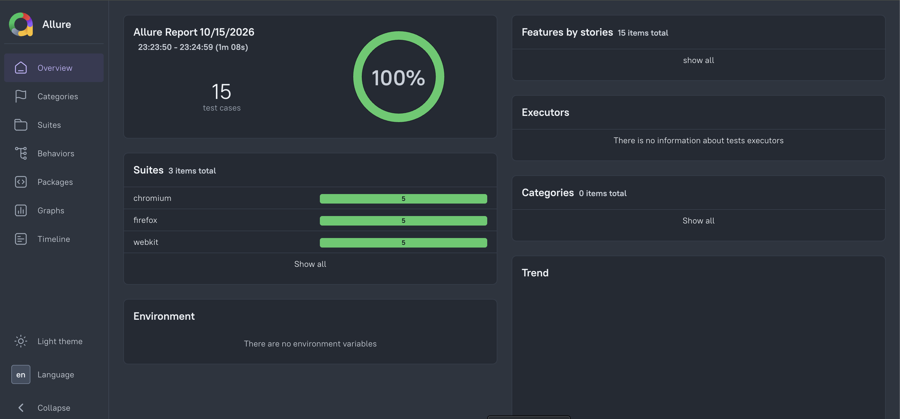

# Automation Exercise Tests

This project [Automation Exercise](https://www.automationexercise.com/) tests signup and login using Playwright and TypeScript . It uses page objects to keep page interactions in one place, fixtures to set up test accounts, and Allure for reports.

## Setup

Requires Node.js 22.13+ and Java 17+ for Allure.

```bash
npm install
npx playwright install
```

Configure `BASE_URL`, `WORKERS`, `RETRIES`, and `HEADLESS` in `.env` as needed.

## Run tests

```bash
# All browsers
npm test

# Headed mode
npm run test:headed

# Chromium only
npm test -- --project=chromium

# Parallel execution
npm test -- --workers=3

# Run a matching scenario
npm test -- --grep "Login with the same account"

# Interactive UI
npm run test:ui
```

Tests run independently in Chromium, Firefox, and WebKit. Each test uses a separate browser context. Accounts use UUID credentials and generated profile data, with setup and cleanup performed through the UI.

## Scenarios

- Registration with required-password validation and successful account creation.
- Duplicate registration rejection.
- Login with a registered account and home-page verification.
- Required-name validation when signup details are empty.
- Required-email validation when only a name is entered.

Five scenarios across three browsers produce 15 test executions. Registration stages appear as steps in the reports.

## Code checks

```bash
npm run typecheck
npm run lint
```

## Reports

```bash
# Open Playwright report
npm run report

# Generate and open Allure report
npm run allure:generate
npm run allure:open
```

| Output | Directory |
|---|---|
| Playwright report | `playwright-report/` |
| Allure results | `allure-results/` |
| Allure report | `allure-report/` |
| Failure screenshots and traces | `test-results/` |

Allure results are cleared before each test run. Generate the Allure report after running tests.

Example Allure report; counts depend on the test run:



## Project structure

```text
src/
  data/          Generated test data
  fixtures/      Page objects and account lifecycle fixtures
  pages/         Page locators, actions, and assertions
tests/           Test scenarios
utils/           Global setup
playwright.config.ts
eslint.config.ts
```

## Troubleshooting

If the website returns a server error, inspect the screenshot and trace. Reduce concurrency with `npm test -- --workers=1` when needed. Account cleanup also requires the website to be available.

## Author

[shubham-shahare](https://github.com/shubham-shahare)
